# weatherman

Weather prediction (temperature & relative humidity) for **Delhi** and **Kolkata** using [Prophet](https://facebook.github.io/prophet/) time-series models.

- **GitHub:** https://github.com/sehgalanmol/weatherman.git
- **Model Card (Hugging Face):** https://huggingface.co/anmolsehgal/weatherman

## Overview

This project forecasts hourly weather variables for two Indian cities using Prophet models trained on historical Meteostat data (2000–2024). The trained models are served through a FastAPI endpoint (`POST /weatherpredictor`) and are downloadable from the Hugging Face Hub.

## Models

| Model | Target | City | File |
|-------|--------|------|------|
| `temp_delhi.pkl` | Temperature | Delhi | `temp_delhi.pkl` |
| `temp_kolkata.pkl` | Temperature | Kolkata | `temp_kolkata.pkl` |
| `rhum_delhi.pkl` | Relative Humidity | Delhi | `rhum_delhi.pkl` |
| `rhum_kolkata.pkl` | Relative Humidity | Kolkata | `rhum_kolkata.pkl` |

Prophet configuration:
- `daily_seasonality: true`
- `weekly_seasonality: true`
- `yearly_seasonality: true`
- Forecast horizon: next 3 days at 6-hour intervals

## Metrics

Evaluation: daily-aggregated backtest, MAE/RMSE on a held-out 90-day test set.

| City | Target | MAE | RMSE | Unit |
|------|--------|-----|------|------|
| Delhi | Temperature | 1.073 | 1.330 | °C |
| Delhi | Relative Humidity | 6.099 | 6.922 | % |
| Kolkata | Temperature | 1.474 | 1.732 | °C |
| Kolkata | Relative Humidity | 4.917 | 6.477 | % |

Full metrics are recorded in `config.json`.

## Data

- Source: Meteostat (Hourly)
- Cities: Delhi, Kolkata
- Time range: 2000-01-01 to 2024-12-31
- Frequency: hourly
- Variables: `temp`, `dwpt`, `rhum`, `prcp`, `wdir`, `wspd`, `pres`, `coco`
- Rows: 438,290
- Missing values handled with domain-aware imputation (see `weatherman.ipynb`)

## Plots

### Temperature over time — Delhi
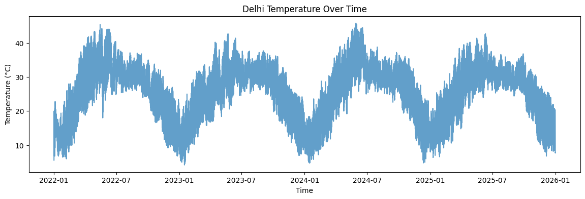

### Relative humidity over time — Delhi
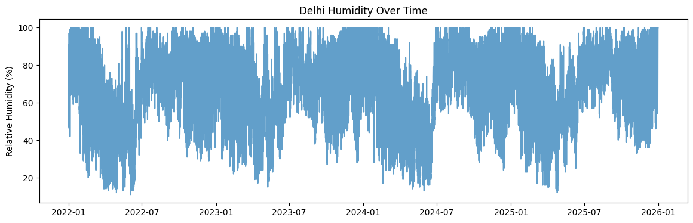

### Delhi — Temperature forecast & components
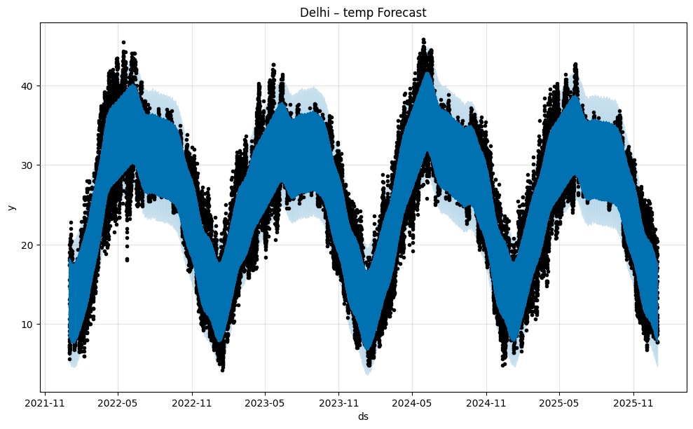
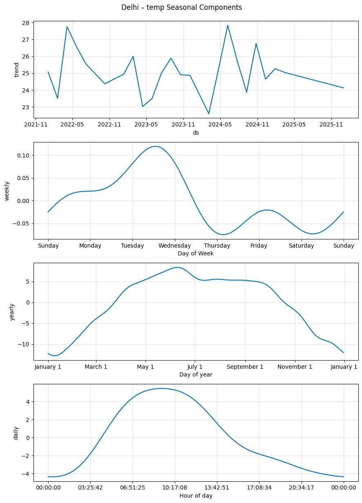

### Delhi — Relative humidity forecast & components
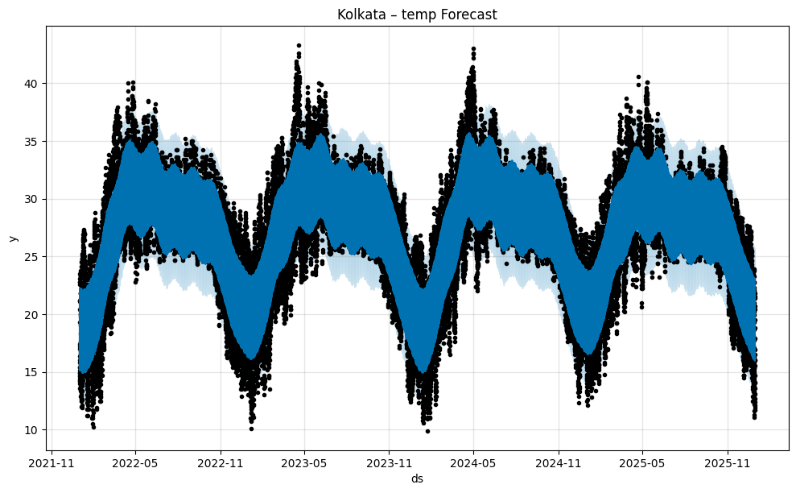
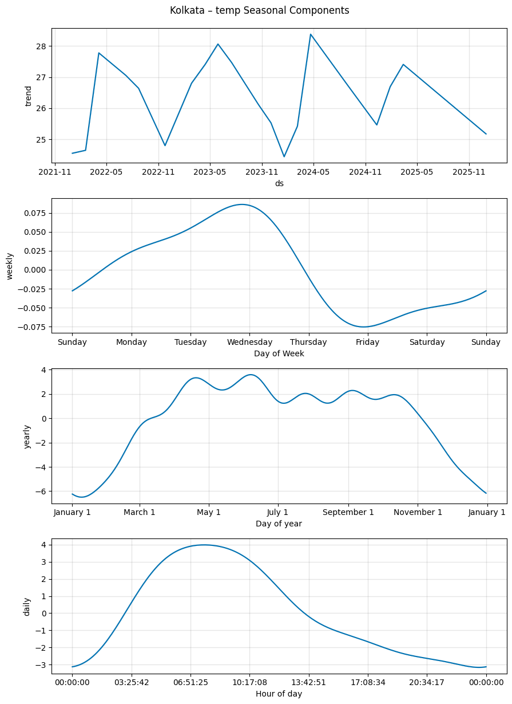

### Kolkata — Temperature forecast & components
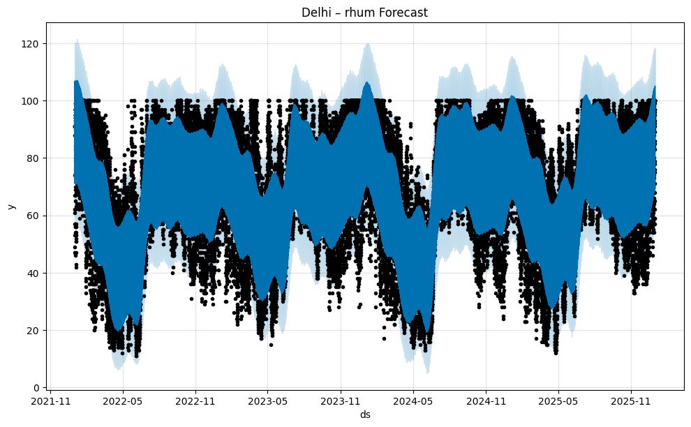
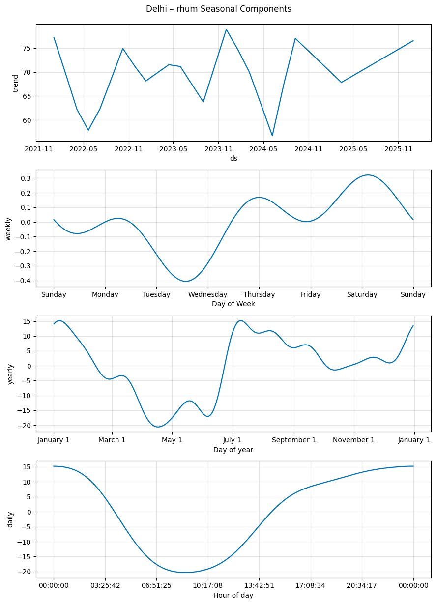

### Kolkata — Relative humidity forecast & components
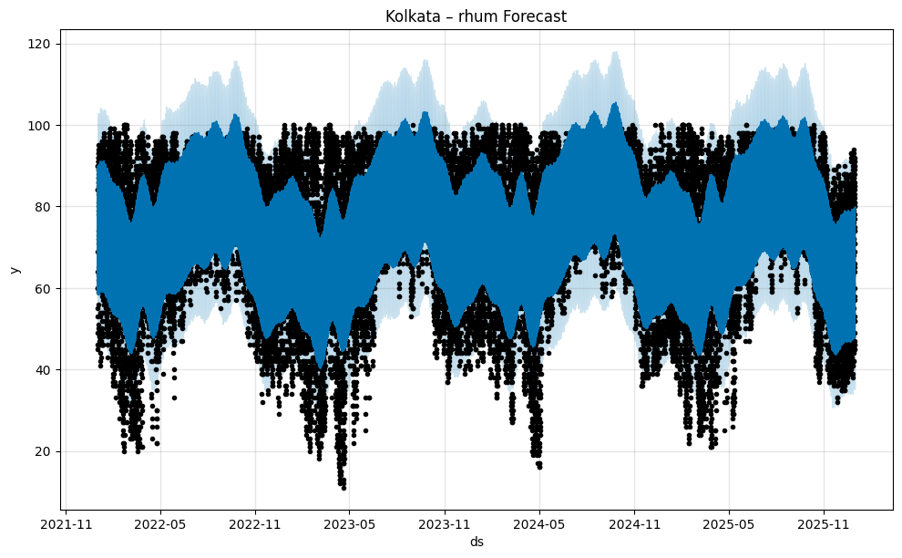
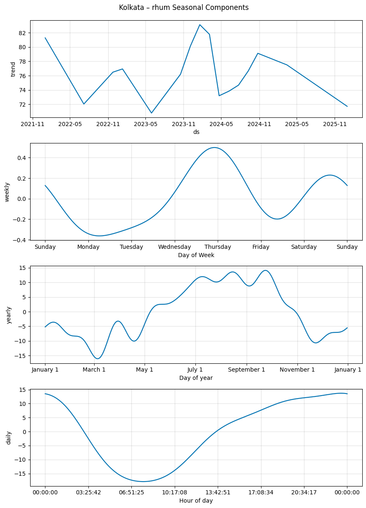

### Yearly temperature seasonality — Delhi vs Kolkata
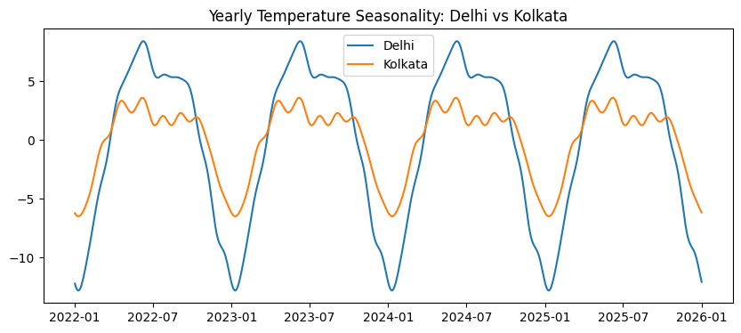

## API

### Request

```http
POST /weatherpredictor
Content-Type: application/json

{
  "type": "temperature",
  "city": "delhi",
  "timestamp": "2026-08-15 14:00"
}
```

### Response

```json
{
  "city": "delhi",
  "type": "temperature",
  "timestamp": "2026-08-15 14:00",
  "prediction": 28.5,
  "lower_bound": 26.1,
  "upper_bound": 30.9
}
```

Valid `type`: `temperature`, `humidity`  
Valid `city`: `delhi`, `kolkata`

## Installation

```bash
pip install -r requirements.txt
```

Requirements: `huggingface_hub`, `uvicorn`, `fastapi`, `pandas`, `pydantic`, `prophet`, `matplotlib`

### Run the API

```bash
uvicorn main:app --host 0.0.0.0 --port 10000
```

### Docker

```bash
docker build -t weatherman .
docker run -p 10000:10000 weatherman
```

## Model loading

Models are fetched from the Hugging Face Hub (`anmolsehgal/weatherman`) via `model_loader.py`:

```python
from huggingface_hub import hf_hub_download
import pickle

model_path = hf_hub_download(repo_id="anmolsehgal/weatherman", filename="temp_delhi.pkl")
with open(model_path, "rb") as f:
    model = pickle.load(f)
```

## Files

| File | Purpose |
|------|---------|
| `weatherman.ipynb` | Training & EDA notebook |
| `config.json` | Model config + metrics |
| `main.py` | FastAPI prediction service |
| `model_loader.py` | Downloads models from Hugging Face Hub |
| `app.py` | Streamlit demo app |
| `requirements.txt` | Python dependencies |
| `dockerfile` | Docker build |
| `plots/` | Generated visualization plots |

## Citation

If you use this project, please cite the Hugging Face model card: https://huggingface.co/anmolsehgal/weatherman
